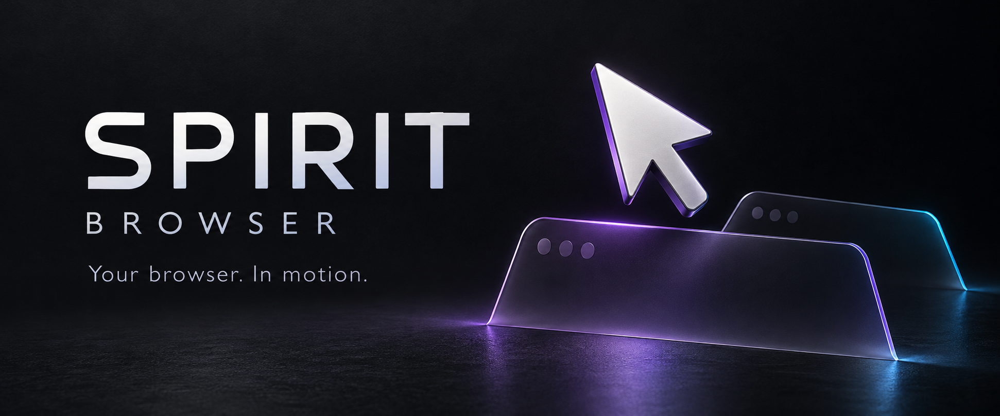

<p align="center"></p>

<p align="center">
<a href="https://github.com/scarrymany/spirit-computer-use/actions/workflows/ci.yml"></a>


<a href="LICENSE"></a>
</p>

<p align="center"><strong>Your tabs. Your session. A cursor of its own.</strong><br>
Browser tools for MCP agents, using the Chrome you already have open.</p>

SPIRIT Browser connects to your ordinary Chrome profile through its own Manifest V3
extension. It sees existing tabs, reads pages, captures background screenshots and sends
input through Chrome DevTools Protocol. Your system mouse stays where you left it.

The Python package and skill retain the name `spirit-computer-use` for existing integrations.
Version 0.2 removes desktop control completely.

## Start on Windows 11

Install Python 3.10-3.13 x64, then run PowerShell:

```powershell
git clone https://github.com/scarrymany/spirit-computer-use.git
cd spirit-computer-use
.\scripts\install.ps1
.\.venv\Scripts\python.exe -m spirit_computer_use browser-setup --destination "$([Environment]::GetFolderPath('Desktop'))\SPIRIT Browser"
```

Open `chrome://extensions`, enable **Developer mode**, choose **Load unpacked**, and select
**SPIRIT Browser** on your desktop. Open the extension popup and press **Connect**.
Keep this folder: Chrome reads the unpacked extension from it.

Generate the configuration for your agent and merge the entry into its existing settings:

```powershell
.\.venv\Scripts\python.exe -m spirit_computer_use config antigravity
# Also: codex, claude, opencode, cursor, vscode, generic
```

Copy `skills/spirit-computer-use` into your client's skill directory. Restart its MCP
connection after an upgrade. See [client setup](docs/clients.md) for paths and compatibility.

## What the agent can do

| Capability | Behavior |
| --- | --- |
| Existing tabs | List titles, URLs and activity; search, open, activate and close |
| Visual understanding | Background PNG, accessible trees, short element refs, iframe and shadow DOM support |
| Independent input | Animated SVG cursor, click/double/right click, drag, scroll, Unicode and shortcuts |
| Forms | Text, select, checkbox, file upload with confirmation |
| Debugging | Console and network metadata, explicit JavaScript with confirmation |
| Files | PNG, PDF and tracked downloads collected into your chosen folder |
| Games | Screenshot/action loop with arrow keys and bounded key holds |
| Tab mentions | MCP resources, copied `@spirit-tab:ID` mentions and exported files for @ pickers |
| Recovery | Fresh snapshots, stale-ref refresh, navigation checks and emergency stop |

Only controlled tabs enter the purple **SPIRIT** group. Disconnect releases them and
restores their original grouping. The visible frame and cursor live inside an isolated
world and shadow root. Chrome also displays its own debugger indicator.

## Connection choices

**Extension first.** `chrome.debugger` attaches to your normal tabs without restarting Chrome,
changing profiles or exposing a debugging port. A token-authenticated loopback bridge accepts
only this extension's exact Origin. Multiple MCP clients share the bridge; one client owns
a tab at a time.

**CDP fallback.** Chrome 144+ offers consent-based access at
`chrome://inspect/#remote-debugging`. Enable it and approve Chrome's connection dialog.
SPIRIT reads the session's `DevToolsActivePort`; it does not launch your default profile
with `--remote-debugging-port`. See [architecture and restrictions](docs/architecture.md).

## Controls and honest limits

- **Stop:** Pause, Ctrl+Alt+Escape, the page's Stop button or the extension popup.
- Password fields require manual input. The agent must ask before purchases, messages,
  deletion and payment entry. Built-in button heuristics cannot understand every website.
- Arbitrary JS and uploads require a separate user confirmation. These are powerful tools;
  website content is untrusted input, not authorization.
- Native @ autocomplete belongs to the host application. MCP resources and tab files provide
  selection where supported; SPIRIT cannot replace another application's composer.
- Chrome's extension debugger does not expose `Browser.setDownloadBehavior`. Extension mode
  tracks its own downloads, then copies completed files into the requested folder. Direct
  CDP uses `Browser.setDownloadBehavior`.
- CDP fallback lacks Chrome extension tab groups and active-tab metadata. Confirmation tools
  still require the extension bridge. Restricted Chrome pages require manual interaction.
- No built-in AI model, game solver or guaranteed score. The connected agent makes decisions.

## Develop and verify

```powershell
.\scripts\install.ps1 -Dev
$env:SPIRIT_TEST_CHROME = .\scripts\install-test-browser.ps1
.\.venv\Scripts\python.exe -m ruff check .
.\.venv\Scripts\python.exe -m ruff format --check .
.\.venv\Scripts\python.exe -m pytest -q
.\.venv\Scripts\python.exe -m build
```

Browser tests run on local fixture pages in an isolated Chrome for Testing profile.
[Validation details](docs/validation.md) distinguish test coverage from client compatibility.
[Third-party notices](THIRD_PARTY_NOTICES.md) record dependencies and design references.

MIT licensed. Built for Windows 11 and agents that speak MCP.
