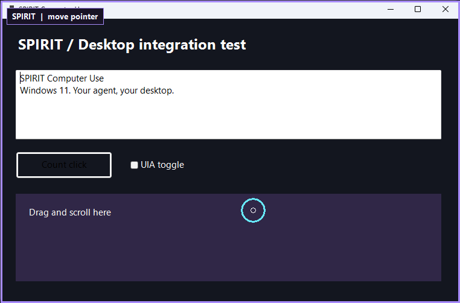

# SPIRIT Computer Use

**Windows 11 computer use for MCP agents and CLI workflows.**

SPIRIT gives an agent window screenshots, accessibility text, mouse and keyboard
tools, with a visible purple window border and cyan pointer halo. One local
engine connects to Codex, Claude Code, OpenCode, Antigravity and other stdio MCP
clients. No model API key, account, cloud service or network listener is required
by the engine itself.



Version **0.1.0**. Independent software inspired by window-scoped computer-use
workflows. It is not a byte-for-byte or API-compatible replacement for the
OpenAI plugin. See [client validation levels](docs/clients.md#validation-levels).

## Install

Requirements: Windows 11 x64, a standard Python 3.10-3.13 installation with Tk,
an unlocked interactive desktop, and Git. Administrator privileges are not required.

```powershell
git clone https://github.com/scarrymany/spirit-computer-use.git
cd spirit-computer-use
./scripts/install.ps1
```

The installer creates `.venv`, checks the runtime and generates connection snippets
under `artifacts/integrations/`. It does not overwrite client settings. If PowerShell
script execution is restricted by your environment, run the underlying commands:

```powershell
python -m venv .venv
./.venv/Scripts/python.exe -m pip install -e .
./.venv/Scripts/python.exe -m spirit_computer_use doctor
./.venv/Scripts/python.exe -m spirit_computer_use config codex
```

Connect using [the client setup guide](docs/clients.md). Add the portable
[skill](skills/spirit-computer-use/SKILL.md) to your agent's skill directory.
The skill provides workflow instructions; the MCP server supplies the actual tools.

For Codex, from the checkout:

```powershell
$pythonPath = (Resolve-Path '.venv/Scripts/python.exe').Path
codex mcp add spirit-computer-use -- $pythonPath -m spirit_computer_use serve
```

## Tools

| Operation | Tools |
| --- | --- |
| Discover | `list_windows`, `get_window`, `list_apps` |
| Observe | `get_window_state`, `status` |
| Focus and launch | `activate_window`, `launch_app` |
| Pointer | `click`, `move_pointer`, `scroll`, `drag` |
| Keyboard | `press_key`, `type_text` |
| Accessibility | `set_value`, `perform_secondary_action` |
| Stop/resume | `emergency_stop`, `resume` |

The agent selects a complete window identity, observes it and then acts using the
returned `snapshot_id`. Input consumes that snapshot. Coordinates are original
physical image pixels, relative to the window. New observations, movement,
resizing and timeouts invalidate old coordinates/indices. Scroll units are wheel
units: 120 is one notch, positive vertical values move down.

Screenshots use Windows Graphics Capture by HWND, including occluded windows.
Accessibility uses UI Automation. Input uses SendInput with foreground and
coordinate hit checks. Unicode input includes surrogate pairs and leaves the
clipboard alone. Standard controls can be edited through UIA without typing.

## Visibility and stopping

The purple frame marks the observed/controlled window. The cyan halo follows
the pointer during activity, then disappears. The overlay is non-activating and
click-through. It does not globally replace the user's cursor theme.

Press **Pause** or **Ctrl+Alt+Escape** to latch an emergency stop. Input stays
blocked until the user asks the agent to `resume`. The monitor continues working
with `serve --no-overlay`. SPIRIT releases its recorded held inputs on worker
timeout/shutdown; actions already delivered cannot be undone.

By default, the overlay is excluded from capture. To include it in a recording,
set `SPIRIT_RECORD_OVERLAY=1` in the MCP server's environment.

## CLI

```powershell
./.venv/Scripts/python.exe -m spirit_computer_use windows
./.venv/Scripts/python.exe -m spirit_computer_use config claude
./.venv/Scripts/python.exe -m spirit_computer_use session
```

`session` accepts one JSON request per line and keeps snapshot state alive:

```json
{"operation":"list_windows","arguments":{}}
```

Send subsequent requests with the returned window and snapshot data. CLI captures
include `image_base64`; MCP returns native PNG image blocks. The `capture` subcommand
takes a listed HWND and a new output filename. It refuses to overwrite existing files.

## Boundaries

- Windows 11 x64 only. macOS, Linux, secure desktops, locked sessions and UAC
  prompts are unsupported. Elevated targets can reject a normal-integrity process.
- Some protected surfaces refuse capture. Minimized windows must be restored.
- UIA content depends on the application. Canvas editors, games and inaccessible
  controls may have sparse trees. `type_text` requires a recognized editable focus;
  password fields require manual entry.
- Popups can have separate HWNDs; select them explicitly. SPIRIT does not yet
  combine all transient surfaces into one snapshot like some integrated products.
- The selected agent/model must support MCP image content for screenshot reasoning.
  A model's errors, client permissions and application behavior are not eliminated
  by the transport. Only automate actions actually authorized by the user.
- SPIRIT does not persist screenshots or typed text unless a CLI output file is
  explicitly requested. MCP observations are transmitted to the connected agent,
  whose provider may process them according to that client's settings.

## Development and verification

```powershell
./scripts/install.ps1 -Dev
./.venv/Scripts/python.exe -m pytest -q -m 'not desktop'
./.venv/Scripts/python.exe -m ruff check src tests scripts
./.venv/Scripts/python.exe -m build
```

Real desktop tests use a disposable .NET 9 WinForms window. They move the mouse
and focus; run them when the desktop is available:

```powershell
dotnet build tests/fixture/Spirit.TestWindow.csproj -c Release
$env:SPIRIT_DESKTOP_TEST = '1'
./.venv/Scripts/python.exe -m pytest -q
```

See [validation results](docs/validation.md), [architecture](docs/architecture.md)
and [third-party notices](THIRD_PARTY_NOTICES.md). The focus attachment technique
is adapted from MIT-licensed Windows-MCP. Microsoft UFO was also reviewed;
no UFO code is included. Runtime dependencies retain their own licenses.

Released under the [MIT license](LICENSE).
