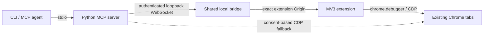

# Architecture

The extension is the primary connection. It requires no separate profile and discovers
already-open tabs through chrome.tabs. Debugger attachment is lazy. Selected tabs enter
a purple SPIRIT group and are restored on release; another MCP owner cannot claim them.
An idle session detaches after five minutes. The bridge binds only 127.0.0.1:47831 and
rotates its token on startup. Registered unpacked installations receive the new token.
Engine connections reject Origin headers; extension connections require the pinned ID.
This protects against web origins, not malicious local software running as the same user.

Bridge credentials and the installation registry live in `%USERPROFILE%\.spirit\browser`.
AppData is unsuitable for shared credentials: Windows MSIX virtualization can redirect
desktop applications and ordinary CLI processes to different files at the same visible path.
When upgrading from 0.2.0, stop the old SPIRIT browser bridge, run `browser-setup` again
with the existing extension directory, and restart your MCP clients. The extension reads
the updated connection settings when it reconnects.

The Python engine owns observation snapshots, navigation generations, AX refs and input
sequencing. Coordinates and PNG dimensions use CSS pixels; devicePixelRatio is returned
separately. OOP iframe sessions are attached through CDP and same-process frames are read
with their frame IDs. Ref refresh is allowed only for one unambiguous accessible identity
in the same frame. Mutations with unknown outcomes are never replayed automatically.

Background input uses focus emulation and an acknowledged 1x1 screencast to keep the tab's
renderer responsive. Screencast frames are discarded. Screenshot capture is separate.
Neither path activates the tab. This was necessary on the tested Chrome builds: focus
emulation alone did not reliably deliver input to an inactive tab.

Input.dispatchMouseEvent and Input.dispatchKeyEvent provide browser-local input. Unicode
uses Input.insertText. Fixed form helpers dispatch input/change for selects; upload uses
DOM.setFileInputFiles. There are no OS input injection APIs. A Windows hotkey watcher only
reads emergency-stop key state. The SVG pointer lives in an isolated world with a closed
shadow root; its host passes events through except for the Stop control. Navigation
reinserts the overlay through Page.addScriptToEvaluateOnNewDocument.

## Chrome API restrictions

Chrome extension debugging exposes a subset of CDP domains. Browser.setDownloadBehavior
is unavailable, and Page.setDownloadBehavior is also rejected as a browser-level command.
Extension downloads are matched to owned Page.downloadWillBegin events, routed through
chrome.downloads, and copied only after completion. Unrelated downloads are not selected
by referrer. Source files remain in Chrome's Downloads directory. Existing destinations
are not overwritten.

Direct downloads use GUID filenames and report only completed downloads owned by the
controlled tab. Browser.setDownloadBehavior is browser-context-wide; it temporarily
affects the default context and is reset to Chrome's default on disconnect. Use extension
mode when other tabs must retain independent download behavior.

Direct CDP uses the existing Chrome session's DevToolsActivePort. Since Chrome 136,
remote-debugging flags are restricted for the default data directory. Chrome 144+ adds
an explicit user-consent connection flow, so that is the supported fallback. It has no
extension-only group/activity APIs. Sensitive actions still use the extension confirmation
UI and fail explicitly if that UI is unavailable.

## Security boundaries

A fresh snapshot is required for input. Stop and navigation changes invalidate actions.
Passwords require manual entry. Upload and arbitrary JS use an extension-owned approval
window; page scripts cannot answer it. Buttons with sensitive labels and Enter get an
additional confirmation guard. These heuristics are not semantic enforcement: the agent
must still obtain authorization for purchases, messages, deletion and payments, including
canvas controls and unfamiliar languages. Arbitrary approved JS can access page data.

References: [chrome.debugger](https://developer.chrome.com/docs/extensions/reference/api/debugger),
[consent-based connection](https://developer.chrome.com/docs/devtools/agents/use-cases/auto-connect),
[remote debugging restrictions](https://developer.chrome.com/blog/remote-debugging-port).
